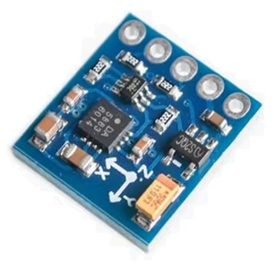
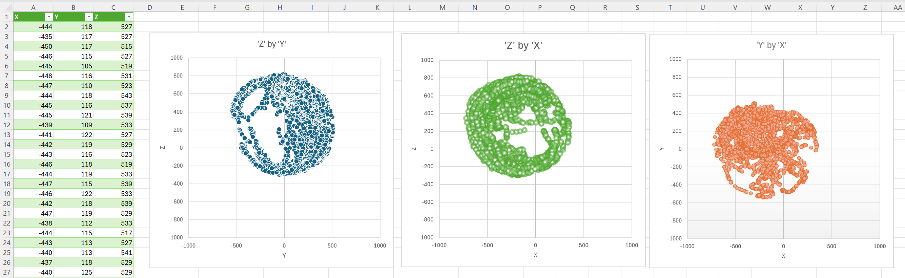

# Arduino Library for QMC5883P 3-Axis Magnetometer

**_PRELIMINARY - Improvements are in progress, especially for calibration_**

The QMC5883P is the latest 3-Axis Magnetometer from QST Corporation. It supercedes the QMC5883L, and the original Honeywell HMC5883L (now obsolete). 



If you buy one of these boards on AliExpress or ebay, it will probably tell you the chip is a (Honeywell) HMC5883L, but this is usually _not true_. You must check the I2C address to find out which chip it really is. These days it's usually a QMC5883P. You will need a different Arduino library for each chip.

HMC5883L = 0x1E (obsolete) \
QMC5883L = 0x0D (superceded) \
**QMC5883P = 0x2C  <- this one is supported by this library**

Connect the board with 3V3, GND, SDA and SCL (some boards also support 5V Arduinos, but check it has an onboard 5V -> 3.3V regulator and I2C level shifters). Verify the I2C address with some simple code in a test sketch,

```cpp
  Wire.begin();
  Wire.setClock(400000);
  Wire.setTimeout(100);

  Wire.beginTransmission(0x1E);
  if (Wire.endTransmission() == 0) {
    // HMC5883L, not supported
  }
  Wire.beginTransmission(0x0D);
  if (Wire.endTransmission() == 0) {
    // QMC5883L, not supported
  }
  Wire.beginTransmission(0x2C);
  if (Wire.endTransmission() == 0) {
    // QMC5883P, IS SUPPORTED :-)
  }
```

On the chip's website page, QST Corp states, "Software and Algorithm Support Available". I tried to contact QST Corporation for more details, but received no response. There's a link to the manufacturer's data sheet and website at the end of this page.


## Using a 3-Axis Magnetometer as a Compass

These devices are useful for detecting the strength and direction of a magnetic field, but _because of their sensitivity to external fields they may not be reliable as compasses_.

The Earth's magnetic field strength is between 0.25 and 0.65 Gauss. The chip has four ranges, ±30 Gauss, ±12, ±8, and ±2 Gauss. So ±2 Gauss is a sensible range for a compass application, leaving some headroom for small external magnetic fields.

The zero-crossing points of the X and Y axes occur at exactly 90 degree angles to magnetic North. But the min and max points do not fall at the midpoints between the two zero-crossings. All the libraries use the `atan2()` method to find the angle.

```
    0         90       180       270       360(0)
    |         |         |         |         |
    012345678 901234567 890123456 789012345 6
X             0                   0          
Y   0                   0                   0
```

You will also need to add 'tilt' compensation if the sensor is not always perfectly horizontal. An Accelerometer is often used for this, but that introduces even more variables. Accelerometers have their own calibration problems too.

This is a very sensitive device. Even the magnetic field from the needle of a traditional hand-held compass will affect the readings. It is also dramatically affected by being close to any electronic, magnetic or metallic objects. If your mobile phone is close by, forget it. Even non-ferrous metals will distort the Earth's magnetic field and distort the readings. Being inside a building with steel reinforcements in the concrete walls distorts the readings too. The horizontal level also has a major effect on the X/Y axis readings.

You can see all these effects if you have a Digital Compass app on your phone. The phone will contain a very similar chip (or maybe even the same one). Most compass apps have a calibration procedure which involves rotating the phone around each axis. Even after calibration, they are not very accurate. They may not work at all if the phone is not horizontal. A traditional hand-held compass is more accurate and far more reliable!

This library's main function is to calculate degrees from north, `getDegreesFromNorth()`. To keep the direction stable, a number of readings are averaged, according to `begin( , uint degreesFromNorthSamples)`. The declination value (described in the next section) is used to compensate for the angle between magnetic north and actual north, and can also be used as a simple linear calibration factor.


## Angle of Magnetic Declination and Magnetic Inclination

The Earth's magnetic north is rarely at the North Pole. It moves about regularly (polar wandering), usually within a few degress. But every 450'000 years (±450'000 years) it flips completely. All compasses will then be pointing south instead of north. We are well overdue for the next flip. But don't worry, it takes between 1000 and 10'000 years to flip completely, so we should have time to update our software. Most hand-held compasses have a rotating dial that points to true north, so simply rotate the dial 180 degrees and you're back in business.

To find the direction of true north, you will need to know the _angle of magnetic declination_, which is the angle between magnetic north and true north. This varies according to your location and the current location of the wandering magnetic pole.

To find out the magnetic declination of your current location (on planet Earth), use NOAA's magnetic declination calculator, \
https://www.ngdc.noaa.gov/geomag/calculators/magcalc.shtml#declination

_The angle of magnetic inclination_ is the angle at which the magnetic field enters the Earth. At the equator, the field runs almost parallel to the surface. As you approach magnetic north the field bends downwards, and towards magnetic south it bends upwards, becoming verticle at the magnetic pole. Magnetometers work very well at the equator, with maximum X/Y readings and a low Z reading. As you move north or south and the angle of inclination increases, the readings from the X/Y axes will drop to almost nothing and the Z axis reading increases. 

This means that magnetometers are not usable if you are too far north or too far south because the X/Y readings are too low.

## Rotation Calibration

The standard calibration procedure requires a full 360 degree rotation of the device for each X/Y/Z axis, storing a range of values for each axis. This must be done with the magnetometer in its final case and mounting position, to compensate for all fixed on-board fields. It calibrates only for local magnetic fields from the nearby on-board electronics and metallic mountings. It cannot calibrate for variable external magnetic fields, which may have an even greater effect than the local fields. If you do this calibration procedure in the presence of variable external fields (e.g. indoors), it will not produce reliable results.

Many implementations just store the max and min values, but this is not a good idea because these will often be OUTLIERS (irregular glitches), and the calibration will be completely wrong! During my tests this was very often the case. Detecting the outliers is quite difficult (see the ArduPilot code). Only the values which fall on the surface of a sphere whose size is determined by the range of the readings should be used (I think).

Another difficulty is how to determine when the calibration is complete. Each library implementation does this in a different way. One tries to detect values looping back past the orginal value to determine a full rotation. One library just waits 10 seconds and assumes that three full rotations have been done. Probably the best way is to detect even coverage of the surface of that sphere mentioned in the previous paragraph.

This library has a basic `rotationCalibration()` method, but it's patched out because the results (as with all the other libraries that have implemented this method) are very dubious. You can enable it and experiment if you like, by un-commenting `//#define QMC5883P_ENABLE_CALIBRATION` in the example sketch. To determine when calibration is complete, this library just waits 10 seconds after the last change of a min or max value, then assumes it's complete. An alternative way would be to wait until the range between the min and the max values relates to the ranges produced by the `selfTest()` method, there is some commented-out example code for this.

For an ideal calibration, you will need a way to accurately rotate the magnetometer and all its electronics about each axis, X, Y, Z. This is difficult to do manually. It really needs a fancy **gimbal-like rotation device**.  Any wires will make rotation difficult and the position and motion of the wires themselves will affect the fields, so you'll need WiFi or Bluetooth communications, which may affect the fields even more. The proximity of batteries, motors and mounting bolts also has a huge (and variable) effect. 

The few descriptions I have found about magnetometer calibration all show circular plots for the readings of the three axes, using X/Y, X/Z and Y/Z axes for each plot. Before calibration, the three circular plots are in different positions. After calibration, the three circular plots are nicely superimposed over each other. If you're interested in seeing this for yourself, you can use Excel for the visualisation. Create a CSV file with a `Serial.println()` statement in `rotationCalibration()`. Import the CSV file into Excel and create three charts using the X/Y, X/Z and Y/Z axes. You will need to modify the charts to use the same axis scales for each plot, -1000 -> 0 -> +1000.





When multiple readings are taken, you can see that the max and min values for each channel are not the same. This is because of the directional effects of nearby magnetic fields (hard effects), nearby metallic (ferrous and non-ferrous) objects which distort the Earth's magnetic field (soft effects), and irregularities within the chip itself. The chip cannot tell the difference, it just sees the accumulated effects on the reading from each axis.

The calibrartion just normalises the offset and the range for each axis. It's easier to visualise if a simple straight-line plot is used.


**Raw axis readings before calibration**
```
               0            
   - 098765432101234567890 +
X      xxxxxxxxxx           
Y        yyyyyyyyyyyyyy     
Z             zzzzzzzzzzz   
   minX|-rangeX-|maxX
     minY|---rangeY---|maxY
          minZ|-rangeZ--|maxZ
```

Calibration adjusts the axes so they all use the same range and the same offset, with 0 as the centre position. But this requires good calibration data, without any outliers.

**Calibrated readings**

```
               0         
   - 098765432101234567890 +
X        xxxxxxxxxxxxx    
Y        yyyyyyyyyyyyy    
Z        zzzzzzzzzzzzz   
               |offset
         |---range---|
```

For real calibration you need to use something like the _Levenberg–Marquardt algorithm_, but that's overkill for my application.


## I2C Lockups

During tests, the I2C bus locked up regularly, probably because of an intermittent connection on the I2C bus. This happened a lot while waving the sensor around during calibration. The I2C bus is locked if a chip permanently holds SDA (the data line) low. If this happens, ALL I2C devices go off line. This is invariably CATASTROPHIC! I2C chips should _always_ release the bus if there is an error, but this does not happen with this chip.

To recover, I added a `resetI2C()` method to the example sketch, which can be called to release the bus if it locks up. This is called from the commented-out calibration loop.


## Solar Tracker Application

My application is for a rudimentary compass on an outdoor Solar Tracker, to give some verification that it's really pointing in the right direction. The magnetometer will be mounted near to large motors and metal mounting brackets, which will have major effects on the accuracy. The motors are permanent magnet motors, causing _hard field_ problems even when they are not running. Both the proximity of the motors and of the mounting brackets (_soft fields_) will change as the positioning system moves about. The calibration is _variable_, so the traditional calibration method will not work.

For me, `getDegreesFromNorth()` is the important method. This doesn't really need complicated calibration. It can all be done with the declination offset, which can be varied a bit according to the position of the motors and brackets. A simple look-up table can be used for that.

The Z-axis is not used for a compass application, because the horizontal position of the sensor will not change. Can the Z-axis can be used to compensate the X and Y axes for the variable hard and soft fields? I will be experimenting with that...


## Installing the Library with the Arduino IDE

Search for 'mumanchu' in the Arduino IDE's Library Manager and look for the `QMC5883PMagnetometer` library. If found, just install it from there.

If not, download the latest Zip file via using green button on this library's Github screen, "<> Code / Download Zip". This creates a file called "QMC5883PMagnetometer-main.zip" in your Downloads directory. Now open the Arduino IDE. Select menu item "Sketch / Include Library > Add ZIP Library...". This opens the "Select ZIP File" window. Open the Downloads directory and choose the "QMC5883PMagnetometer-main.zip" file you just downloaded. You should see a "Successfully installed library" message.

To open the example sketch, select menu item "File > Examples" and scroll down beyond "Examples from Custom Libraries" and choose the "QMC5883PMagnetometer > QMC5883PMagnetometer" entry. This opens the "QMC5883PMagnetometer.ino" example sketch in a new Arduino IDE window.


## Class Reference

To find out what each method does, open the [QMC5883PMagnetometer.h](src/QMC5883PMagnetometer.h) source file and read the comments for each method. The rest is explained in the data sheet, so I won't reproduce it here.

The class definition and the code are in a single `.h` file, because the class will normally be referenced from only one file (`.ino` or `.cpp`) so there's no need for separate `.h` and `.cpp` files.

The library's main application is to calculate degrees from north, `getDegreesFromNorth()`. To keep it stable, a number of readings are averaged, the number of samples to average is set by `begin( , uint degreesFromNorthSamples)`. Each sample uses 4 bytes (2 x 16-bit X/Y values). See [RollingAverage.h](src/RollingAverage.h).


```cpp
class QMC5883PMagnetometer
{
public:
	// Range values from selfTest()
	int testRangeX, testRangeY, testRangeZ;

	// Calibration factors from rotationCalibration()
	float offsetX, offsetY, offsetZ;
	float scaleX, scaleY, scaleZ;

	bool begin(TwoWire* twoWire, uint degreesFromNorthSamples = 0);
	bool softReset();
	bool selfTest();
	bool configure(uint outputDataRate, uint overSampling, uint downSampling);
	bool setRange(uint range);
	bool setOperatingMode(byte operatingMode);
	bool readOperatingMode(byte* operatingMode);
	bool readStatus(bool* rdy, bool* ovf);
	bool readMeasurements(int* x, int* y, int* z);
	float getGauss(int measurement);
	uint getDegreesFromNorth(int x, int y, int z, 
		uint declinationDegrees, uint declinationMinutes);
	bool rotationCalibration();
	bool applyCalibration(int x, int y, int z, int* xc, int* yc, int* zc);
};
```


## Example Sketch

The example sketch does a QMC5883P software reset, calls the self test method, initializes the QMC5883P in 'normal mode' and polls the `RDY` status until new readings are available. The readings are then displayed on the `Serial` output. Floating point values are shown if they are supported by `sprintf("%f")`, see `floatSupportedInSprintf`. The older AVR Arduinos do not support this.

For old AVR Arduinos, you could use the minimalist `floatToString()` function for the conversion, \
https://github.com/mumanchu/mumanchu/blob/main/utils/Float.cpp

In the example sketch, if you un-comment `#define QMC5883P_ENABLE_CALIBRATION`, then it will call `rotationCalibration()` in a loop, so you can test the calibration procedure. This king of calibration did not work very well for me.
```cpp
// Un-patch this to run the rotationCalibration() tests
//#define QMC5883P_ENABLE_CALIBRATION
```

Everything else is self-explanatory, except maybe the 'Self Test' and the 'Set/Reset Mode' features...


## Self Test

P16 of the data sheet states, "_an inner-built current is generated and an additional signal is added to the sensor, generating a difference in the 3 axis value. User should record the value before and after the self-test and compare with a threshold value._" That's not really enough information.

I think the self test results are actually _range_ values. These are the ranges produced by an on-chip-generated field of about 1 Gauss, which overrides any weaker external fields. These can be used as ball-park range values (instead of the calibration), remembering that the Earth's magnetic field is less than 1 Gauss. What we do not get from the self test are the _offsets_.

I think the self test does this for each axis,
- Takes a measurement of the ambient field, which includes the external hard and soft fields
- Generates an internal ~1 Gauss offset field and takes another measurement
- Saves the difference between the two measurements, this is the _range_ value for the axis (some call it the _scale_)

The older QMC5883L data sheet suggested using the self-test results for temperature compensation. This is not necessary with the new QMC5883P, which does the temperature compensation internally. (You can test this with a ~~blowtorch~~ infrared lamp. I found it to be very stable.)


## Set/Reset Mode

This setting is not fully described in the data sheet. The _mumanchu_ library keeps the default setting, SET AND RESET ON. I'm not sure why you would want to change this.

The QMC5883P set/reset mode is a configuration setting used to control the internal Anisotropic Magnetoresistive (AMR) sensor's set and reset driver to eliminate sensor offset and maintain measurement accuracy.

* Set and Reset On (0x00 / ON): Actively performs both set and reset operations to clear residual magnetization and minimize offset errors.
* Set Only On (0x01 / SETONLY): Applies only the set pulse to magnetize the bridge in a preferred direction without the corresponding reset (de-magnetize) pulse.
* Set and Reset Off (0x02 / OFF): Residual magnetism remains (and builds up?), the sensor offset is never updated.


## References

**QMC5883P Data Sheet, Rev.E** \
The page references refer to this version of the data sheet, \
https://www.qstcorp.com/upload/pdf/202512/2C939E5AA0704285BC3BE71132B8629B.pdf

**QMC5882P Manufacturer's Website Page** \
https://www.qstcorp.com/en_comp_prod/QMC5883P

**NOAA Magnetic Declination Calculator** \
To find out the magnetic declination of your current location (on planet Earth), use this nice app from NOAA, \
https://www.ngdc.noaa.gov/geomag/calculators/magcalc.shtml#declination


**NXP/Freescale Semiconductor Application Note AN4246** \
Calibrating an eCompass in the Presence of Hard- and Soft-Iron Interference \
https://www.nxp.com/docs/en/application-note/AN4246.pdf

**NXP/Freescale Semiconductor Application Note AN4248** \
Implementing a Tilt-Compensated eCompass using Accelerometer and Magnetometer Sensors \
https://www.nxp.com/docs/en/application-note/AN4248.pdf

## Existing Libraries

**ArduPilot Magnetometer Code** \
This is the complexity you need to make these chips work reliably in drones. It supports several different chips and has comprehensive calibration features. It even calibrates for the motors. \
https://github.com/ArduPilot/ardupilot/tree/master/libraries/AP_Compass

**Micropython Library** \
I never use Monty Python, but this implements a very simple (i.e. not very useful) version of the rotation calibration procedure,
https://github.com/Turbofan3360/ESP32-Micropython-GY-271-QMC5883P-Driver

**Adafruit Library** \
This is the simplest library. But it uses the 'Adafruit_BusIO_Register' class, which I do not like - its constructors generate lots of additional code, when a line or two of simple logic would do the job. \
https://github.com/adafruit/Adafruit_QMC5883P


## Revision History

| Date  | Revision | Description |
|:---------- |:---------|:----------- |
| 2026.10.24 | 0.0.1	| Preliminary |


## Joke of the Week

_What's green, flat and always points North?_

A magnetic field.

